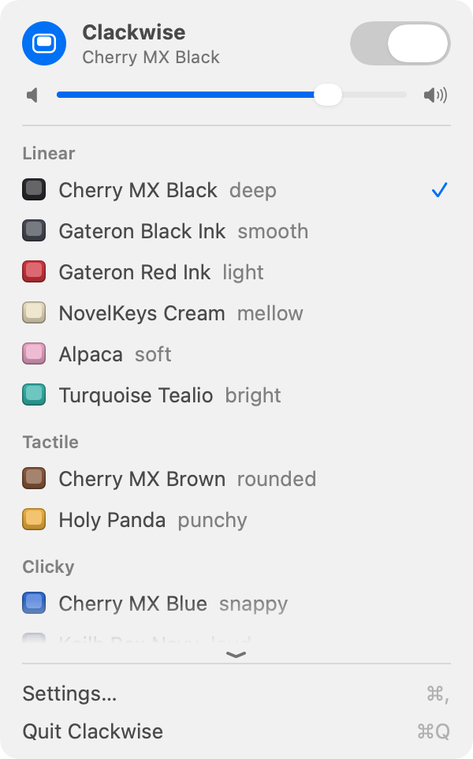

# Clackwise

Mechanical keyboard sounds for every key on your Mac, in every app. The clack lands with your finger.

Click the keycap in the menu bar to switch it on or off, set the volume, and click a pack to hear it.

<picture>
  <source media="(prefers-color-scheme: dark)" srcset="docs/screenshots/panel-dark.png">
  
</picture>

## What it feels like

Sound that trails your finger feels wrong, so latency is what Clackwise is built around:

- **Lead-in trim.** Many recordings start with quiet pre-travel noise before the click. Clackwise starts each
  sound right at the click, so the clack arrives with the press, not after it.
- **About 16 ms** from key event to sound on the built-in speakers, **about 5.5 ms** on wired headphones
  (estimated from the audio system's reported latencies, not measured with a microphone). The
  built-in speakers' own processing is most of the 16 ms.
- 17 sound packs: 13 with recorded key-up sounds (Cherry MX, Gateron, Topre, Box Navy, buckling spring and
  more) and 4 classic Mechvibes packs with synthesized key-ups.

## Dynamics

On MacBooks that have a motion sensor, Clackwise reads it (about 800 times a second) to tell a hard press
from a soft one. Harder presses sound a little brighter and sharper, softer ones a little mellower, with
loudness moving only about ±2 dB. It is meant to be subtle, and the slider goes from "Even" (every key alike)
to "Strong".

Limits: hard and soft presses separate cleanly. Normal and soft presses overlap. The sensor isn't under the
middle of the keyboard, so Clackwise corrects for each key. It adapts to your typing over the first thousand
keys. Reading the sensor adds no latency. The details are in [How it works](docs/HOW-IT-WORKS.md).

## Privacy

- Nothing you type is stored or sent. Clackwise has no network code, no analytics and no update check.
- It keeps per-key press counts and the typical press strength per key, plus aggregate timing (how long
  sounds take). It never keeps text, key order or timestamps. Everything lives in
  `~/Library/Application Support/Clackwise/`; delete the folder to reset.
- It needs **Input Monitoring** to hear key presses (listen only; it never changes or blocks a key).
  The motion sensor needs no permission.
- Password fields: macOS hides typing from every app, so Clackwise goes quiet there.

## Compatibility

- **With dynamics:** MacBooks that have the motion sensor: MacBook Air with M2 or later, MacBook Pro 14" and
  16" (M1 Pro and later), 13" MacBook Pro with M2. This comes from public reports; only a MacBook Air (M4)
  has been tested here.
- **Without dynamics:** M1 MacBook Air, 13" M1 MacBook Pro, Intel Macs and desktop Macs have no such sensor.
  Clackwise detects that and plays every key at the normal level; Settings says so.
- A universal app for Apple silicon and Intel Macs. The Intel build was tested only under Rosetta on an
  Apple silicon Mac, not on real Intel hardware.
- macOS 14 or later (tested on macOS 27 only). Bluetooth and AirPlay outputs are muted by default
  because they add 100 ms or more of delay; you can allow them in Settings.
- The sensor interface is undocumented and may change with a macOS update. If it does, Clackwise falls back
  to the normal level.

## Install

Clackwise is not notarized (no paid Apple Developer account), so macOS blocks the first launch. This is
a one-time step:

1. Download `Clackwise-1.0.0.zip` from [Releases](https://github.com/bobk4ta/clackwise/releases/latest),
   double-click it to unzip, and drag **Clackwise.app** into **Applications**.
2. Open Clackwise. macOS shows **“Clackwise.app” Not Opened**: "Apple could not verify “Clackwise.app” is free
   of malware that may harm your Mac or compromise your privacy." Click **Done**, not "Move to Trash".
3. Open **System Settings → Privacy & Security** and scroll to **Security**. Below "Allow applications from:
   App Store & Known Developers" it says "“Clackwise.app” was blocked to protect your Mac." Click
   **Open Anyway**. The button only appears after you have tried to open the app, so if it is missing, open
   Clackwise once more, click **Done**, and look again.
4. Confirm with Touch ID or your password. If macOS asks once more whether to open the app, confirm again.

Prefer the Terminal? `xattr -dr com.apple.quarantine /Applications/Clackwise.app`, then open the app.

Then macOS asks for Input Monitoring, which is how Clackwise hears your keys. It shows
**Keystroke Receiving**: "“Clackwise.app” would like to receive keystrokes from any application. Grant
access to this application in Privacy & Security settings, located in System Settings."

> **Click Open System Settings, not Deny.** Deny is the blue default button, so don't press Return here.

Then in **Input Monitoring** switch on **Clackwise**, confirm with Touch ID or your password, and click
**Quit & Reopen**. Clackwise's welcome window walks you through this with a small note next to each macOS
dialog.

If you chose Deny, macOS will not ask again, but nothing is lost: the welcome window says so and has an
**Open Input Monitoring** button. By hand: **System Settings → Privacy & Security → Input Monitoring**, switch
on **Clackwise**.

Clackwise lives in the menu bar (no Dock icon). Open the app again at any time for Settings. Default shortcut
to turn sounds on or off: ⌃⌥⌘K.

The Release lists a SHA-256 for the zip. To check: `shasum -a 256 Clackwise-1.0.0.zip`.

## Build from source

Needs macOS 14 or later and the Xcode Command Line Tools (Swift 6).

```sh
git clone https://github.com/bobk4ta/clackwise.git && cd clackwise
scripts/build_app.sh                    # build, sign, install to ~/Applications/Clackwise.app
.build/release/keyimpact selftest       # checks that need no permissions and no audio device
```

The build creates a self-signed code-signing identity in its own keychain on your Mac (your keychain
search list stays as it is). With a stable identity, macOS keeps the Input Monitoring permission across
rebuilds. `keyimpact` is the command-line toolbox behind the app: sensor probe, latency measurement, pack
inspection and the self tests (`keyimpact` with no arguments lists them).

## Credits

Clackwise bundles recordings from [kbsim](https://github.com/tplai/kbsim) by Thomas Lai and
[Mechvibes](https://github.com/hainguyents13/mechvibes) by Hai Nguyen, and adapts its sound pack parsing
from [Clacky](https://github.com/jasonzh0/Clacky). Its sensor code is its own, written from what
[olvvier/apple-silicon-accelerometer](https://github.com/olvvier/apple-silicon-accelerometer) and
[posthog/meepslap](https://github.com/posthog/meepslap) documented about the interface; those two are
references only, and no code from them is included. Inspired by [Haptyk](https://www.haptyk.com/).
Built with Claude Code. Licenses: [LICENSE](LICENSE) and [THIRD_PARTY_LICENSES](THIRD_PARTY_LICENSES).
